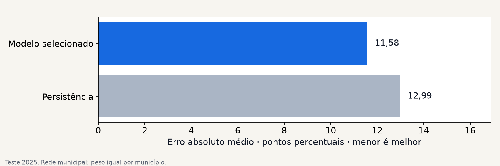
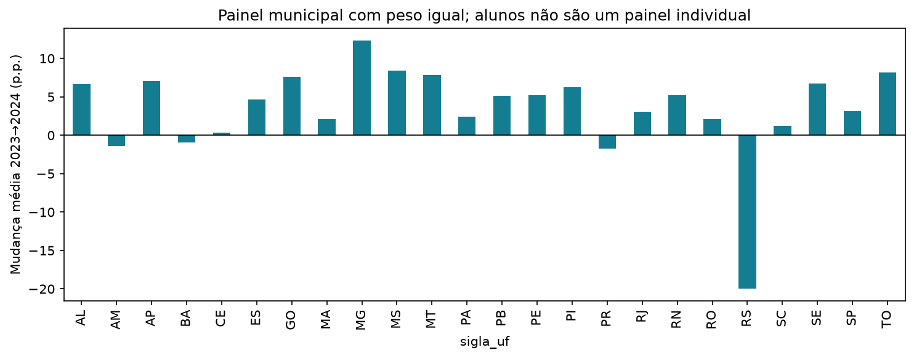

# Predição contextual de alfabetização

Tech Challenge — Fase 3 · FIAP Pós-Tech AI Scientist

Este projeto analisa a alfabetização no Brasil em duas escalas: o risco de não
alfabetização por aluno, estimado a partir do contexto territorial, e a taxa de
alfabetização da rede municipal. O objetivo é identificar padrões, comparar
modelos com referências simples e apoiar a investigação de municípios que
podem ficar abaixo das metas oficiais.

A base educacional dá continuidade à
[fase 2](https://github.com/kevinbds/tech-challenge-fase2-alfabetizacao-pipeline/tree/d583233a633bf878c3c72308569140564404bbab).
As camadas Bronze, Silver e Gold são reconstruídas localmente em DuckDB e
Parquet. Da [fase 1](https://github.com/kevinbds/tech-challenge-fase1-nps-preditivo),
o trabalho retém a organização da análise e o cuidado com validação e comunicação.

## Dados

As fontes são públicas, do INEP e do IBGE. O arquivo
[sources.lock.json](config/sources.lock.json) registra as URLs e os hashes usados
na execução, permitindo verificar se uma nova aquisição recupera os mesmos dados.

| Fonte | Período | Aplicação |
| --- | --- | --- |
| AEEB/INEP | 2023–2025 | Rótulo oficial e indicadores de alfabetização |
| Resultados e metas municipais, estaduais e nacionais | Edição 2024 | Metas de 2024 a 2030 |
| INSE municipal | 2021 | Contexto socioeconômico por rede |
| Censo Demográfico, agregado 4714 | 2022 | População e densidade municipal |
| Diretório de municípios do IBGE | Versão fixada na coleta | Identificação e organização territorial |

A classificação considera alunos do segundo ano das redes estadual e municipal,
com rótulo binário válido e peso oficial positivo. O alvo é o próprio indicador
de alfabetização da fonte; ele não é reconstruído a partir da proficiência.
O teste de 2025 reúne **1.966.095 registros elegíveis**, de 5.556 municípios.
A regressão municipal utiliza **5.500 municípios** no mesmo ano.

Os arquivos individuais permanecem fora do repositório. As saídas publicadas
contêm estatísticas agregadas, indicadores e projeções municipais. Exclusões,
ausências e diferenças de cobertura são descritas nos
[contratos dos dados](docs/data-contracts.md).

## Método

O desenvolvimento usa resultados de **2024 com contexto de 2023**. A avaliação
temporal usa resultados de **2025 com contexto de 2024**. Em 2024, 20% dos
municípios são reservados para calibração e definição do limiar; nos demais 80%,
a seleção usa validação cruzada com cinco divisões agrupadas por município.
As duas tarefas compartilham essa partição, com semente 42.

O conjunto de atributos tem oito variáveis:

- taxa de alfabetização e média de Português do ano anterior;
- INSE municipal de 2021;
- logaritmo da população e densidade demográfica de 2022;
- UF, região e rede de ensino.

Imputação, codificação de categorias e escala são ajustadas dentro de cada
divisão de treinamento. Identificadores, proficiência individual e resultados
do próprio ano ficam fora dos atributos. Os pesos oficiais entram no ajuste,
na calibração e nas métricas da classificação; a regressão dá peso igual a
cada município.

| Tarefa | Modelos comparados | Critério de seleção | Referências |
| --- | --- | --- | --- |
| Classificação de risco | Regressão logística, Random Forest e HistGradientBoosting | Average precision ponderada | Prevalência e risco do contexto anterior |
| Taxa municipal | Ridge, Random Forest e HistGradientBoosting | MAE em pontos percentuais | Persistência da taxa anterior |

As escolhas são concluídas antes da avaliação de 2025. O classificador recebe
calibração sigmoid e um limiar que maximiza F2 na reserva de 2024. Os modelos
avaliados são preservados separadamente dos modelos reajustados para projetar
2026. O [protocolo de modelagem](docs/model-protocol.md) detalha essas etapas.

## Resultados de 2025

### Classificação contextual

Random Forest foi selecionado na validação de 2024. No teste temporal, sua
average precision ficou próxima à do contexto anterior, sem ganho demonstrado
nesse critério. O erro das probabilidades, medido por Brier, foi menor.

| Métrica ponderada | Random Forest calibrado | Contexto anterior |
| --- | ---: | ---: |
| Average precision | 0,459088 | 0,459571 |
| ROC AUC | 0,637691 | 0,643378 |
| Brier — menor é melhor | 0,217336 | 0,218960 |

A diferença de AP foi −0,000483, com IC95% de [−0,002943; +0,001808], incluindo
zero. Para Brier, o intervalo da diferença foi [−0,002357; −0,000869]. Esses
intervalos vêm de 500 reamostragens pareadas por município e descrevem a
variabilidade condicional dos dados observados.

No limiar F2 de **0,184953**, a precisão foi **35,84%** e o recall **98,03%**.
Entretanto, **93,56% dos registros** foram sinalizados como risco. O resultado
tem baixa seletividade: o recall elevado, sozinho, não sustenta uma política de
triagem com capacidade limitada. Alunos com os mesmos atributos contextuais
podem receber a mesma probabilidade; o modelo não constitui diagnóstico individual.

### Taxa de alfabetização municipal

HistGradientBoosting reduziu o MAE em **1,41 p.p. (10,87%)** diante da persistência.
A comparação utiliza os mesmos 5.500 municípios, com peso igual por município.

| Métrica | HistGradientBoosting | Persistência |
| --- | ---: | ---: |
| MAE, em pontos percentuais | 11,5775 | 12,9889 |
| RMSE, em pontos percentuais | 14,7329 | 17,0108 |
| R² | 0,181648 | −0,090978 |

O IC95% da diferença de MAE foi [−1,6155; −1,2478] p.p. As bandas exploratórias
formadas pelos quantis 5% e 95% dos resíduos cobriram **77,33%** do teste,
abaixo da referência nominal de 90%, com largura média de 38,71 p.p.
Essa subcobertura limita o uso das bandas como medida de incerteza futura.



## Projeções e interpretação territorial

O reajuste com dados de 2024 e 2025 produz uma projeção de 2026 para 5.500
municípios. Os maiores déficits previstos entre os municípios com meta avaliável
foram São Sepé/RS (−35,68 p.p.), Canguçu/RS (−34,32 p.p.) e Canela/RS
(−31,06 p.p.). São pontos de partida para investigação local, sem avaliação
independente dos resultados de 2026.

Para 2027–2030, o cenário mantém a taxa projetada de 2026 e a confronta com as
metas de cada ano. Ele não representa uma nova previsão desses quatro anos.

| Ano-meta | Atingiriam a meta | Não atingiriam | Sem meta avaliável |
| --- | ---: | ---: | ---: |
| 2027 | 3.016 | 2.319 | 165 |
| 2028 | 2.615 | 2.720 | 165 |
| 2029 | 2.191 | 3.144 | 165 |
| 2030 | 1.749 | 3.586 | 165 |

K-Means identificou quatro grupos descritivos em 2025, com silhouette de 0,294
e estabilidade ARI de 0,843. O grupo 2 reúne 2.034 municípios, taxa média de
64,79% e INSE médio de 4,35, com maior presença no Nordeste e Norte. O grupo 1
reúne 2.313 municípios, taxa média de 81,86% e INSE de 5,07, com maior presença
no Sudeste e Sul. Os grupos resumem semelhanças; não tornam cada região homogênea.

A permutação de atributos apontou a média de Português defasada, a taxa de
alfabetização defasada e a UF como as maiores influências na AP ponderada.
SHAP descreveu o estimador-base em 256 contextos de desenvolvimento, antes da
calibração. Essas associações não estimam efeitos de intervenções educacionais.

Na EDA, o painel de 5.396 municípios comuns a 2023 e 2024 apresentou aumento
médio de 2,67 p.p., com peso igual por município. Em 2024, 2.788 das 5.232 metas
avaliáveis foram atingidas (53,29%); 216 municípios observados não tinham meta.



## Reprodução

Requisitos: Python 3.12 ou 3.13, `uv`, Git e `curl`. Execute os comandos na raiz
do projeto. O Chromium do Playwright é usado para gerar os documentos.

```powershell
uv sync --frozen --extra dev
uv run playwright install chromium
uv run fase3 doctor

$privateRoot = Join-Path $env:USERPROFILE ".cache\fiap-fase3"
$runOutput = Join-Path $privateRoot "runs\oficial-001"
$reportOutput = Join-Path $privateRoot "reports\oficial-001"
uv run fase3 acquire --mode reproduce --cache "$privateRoot" --expected-manifest config/sources.lock.json
$prepared = uv run fase3 prepare --cache "$privateRoot" --manifest config/sources.lock.json | ConvertFrom-Json
$marts = $prepared.marts_dir
$env:FASE3_MARTS = $marts
$env:FASE3_EDA_OUTPUT = Join-Path $privateRoot "eda\desenvolvimento"
```

Execute [01_eda.ipynb](notebooks/01_eda.ipynb) para explorar 2023–2024. Em seguida:

```powershell
uv run fase3 train --marts "$marts" --output "$runOutput" --protocol config/protocol.json
uv run fase3 scenarios --metrics "$runOutput/metrics.json" --targets "$marts" --output "$privateRoot/scenarios/oficial-001"
uv run fase3 report --metrics "$runOutput/metrics.json" --supplement "$privateRoot/scenarios/oficial-001/scenarios.json" --output "$reportOutput"
```

O comando `fase3 run` encadeia aquisição, preparação, EDA, modelagem, cenários e
relatórios. Para ele, escolha diretórios novos de execução e saída. Os notebooks
[02_modelagem.ipynb](notebooks/02_modelagem.ipynb) e
[03_municipios.ipynb](notebooks/03_municipios.ipynb) leem os resultados agregados;
defina `FIAP_RUN_DIR` com o diretório da execução que será consultada.

Os modelos do pacote de entrega distinguem avaliação de 2025 e projeção de 2026.
Na classificação, aplique `probabilidade >= metadata["threshold"]`, com risco
positivo igual a 1. Na regressão, limite a previsão a 0–100. As métricas de teste
pertencem aos modelos avaliados, e não aos modelos reajustados.

No pacote, `models/model-provenance.json` relaciona os hashes originais dos modelos
aos hashes das cópias empacotadas.

```powershell
uv run pytest -q
uv run ruff check src tests scripts
```

## Organização e limites

| Diretório | Conteúdo |
| --- | --- |
| `src/alfabetizacao_ml/` | Aquisição, preparação, modelos, avaliação e visualização |
| `notebooks/` | EDA, análise dos modelos e estudo municipal |
| `config/` | Fontes fixadas e parâmetros da execução |
| `reports/` | Métricas, cenários, relatório técnico e apresentação |
| `images/` | Figuras da análise exploratória |
| `tests/` | Testes de dados, temporalidade, ponderação e resultados |

O backtest utiliza revisões disponíveis na coleta, sem recuperar as versões
históricas das fontes. A cobertura muda entre anos, o INSE e o Censo têm datas
anteriores ao desfecho e há poucos períodos para estudar mudanças de contexto.
As conclusões são preditivas e descritivas, sem identificação causal.

Novas coortes permitirão avaliar a estabilidade dos modelos, recalibrar as
probabilidades e revisar as bandas de incerteza. A aplicação educacional exige
também discussão com especialistas e avaliação própria das intervenções propostas.
